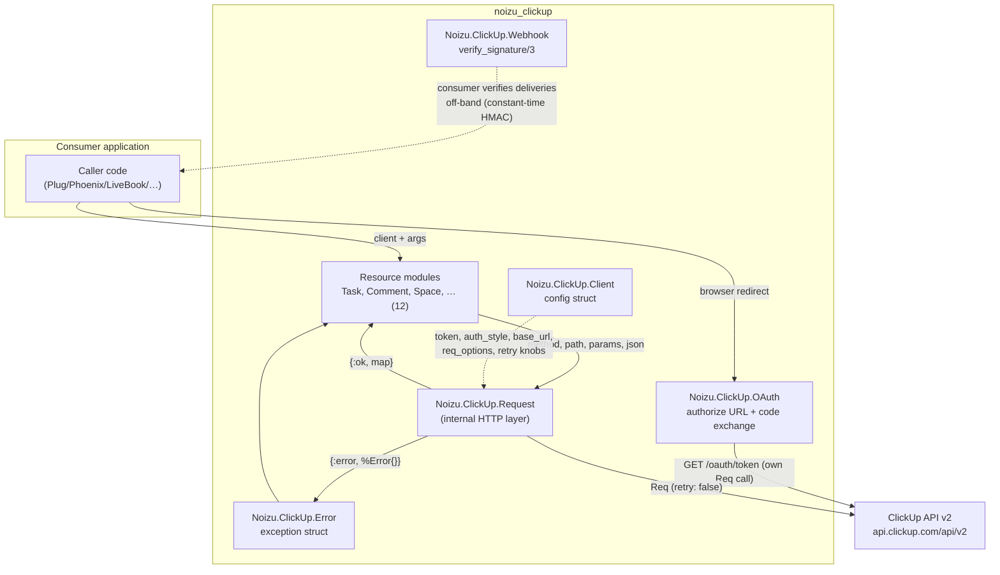

# Project Architecture

<!-- 〚📁:42f0119c-3fa3-52bc-a359-3da9bfd5364a〛 noizu_clickup:proj_arch :: Architecture overview — components, request lifecycle, errors/retry, tech stack, key decisions. -->

`Noizu.ClickUp` (`noizu_clickup`) is an Elixir client library for the
[ClickUp API v2](https://developer.clickup.com). It is a thin, stateless,
contract-first wrapper: [`docs/API-CONTRACT.md`](API-CONTRACT.md) is the source
of truth for endpoint coverage, pagination, errors, and retry behavior —
deviations are bugs. There is no server component, no supervision tree, and no
global state; every call is a plain function from a config struct to a tuple.

## System Diagram

<!-- 〚📐:b4d161ac-ed04-5a62-a5fb-39eaae4dca77〛 noizu_clickup:arch_diagram :: System diagram — consumer → resource modules → Request layer → ClickUp API v2, with OAuth and webhook-verify side paths. -->

<!-- 〚/📐:b4d161ac-ed04-5a62-a5fb-39eaae4dca77〛 -->

## Core Components

| Component | Purpose |
|-----------|---------|
| `Noizu.ClickUp.Client` | Config struct (token, `auth_style`, `base_url`, `req_options`, retry knobs); passed explicitly to every call; optional app-env defaults via `new/0` |
| `Noizu.ClickUp.Request` | Internal HTTP layer — all 12 resource modules route through it: Req wiring, `key[]` query encoding, bounded 429 retry, error shaping |
| `Noizu.ClickUp.Error` | Exception struct `status / code / message` — the single error type across API and transport failures |
| Resource modules | `User`, `Workspace`, `Space`, `Folder`, `List`, `Task`, `Comment`, `CustomField`, `Member`, `Tag`, `TimeEntry`, `Webhook` — one module per API resource |
| `Noizu.ClickUp.OAuth` | Authorization-code grant: consent URL builder + `GET /oauth/token` exchange (no token required for the exchange) |
| `Noizu.ClickUp.Webhook` | Webhook CRUD + `verify_signature/3` — constant-time HMAC-SHA256 check of the raw delivery body |

→ *Components ↔ directories: see [PROJ-LAYOUT.md](PROJ-LAYOUT.md); module-by-module
detail in [layout/lib.md](layout/lib.md)*

## Request Lifecycle

Every call follows one path: the resource module builds a path plus optional
query/body and delegates to `Request.request/4`, which constructs a `Req`
request (auth header from the client, `retry: false` so the library's own
retry is the only retry layer, consumer `req_options` merged last for
test stubs or transport tuning). A 2xx returns the decoded JSON as-is; a 429
sleeps until `X-RateLimit-Reset` (clamped, bounded retries) and re-issues; any
other status or transport exception is shaped into `%Noizu.ClickUp.Error{}`.

→ *See [arch/data-flow.md](arch/data-flow.md) for the full walkthrough, query
encoding, and the two pagination models*

## Errors and Retry

One error type for everything: HTTP failures carry `status` plus the ClickUp
`ECODE` string; transport failures carry `status: nil`. Only HTTP 429 is
retried — never 5xx or timeouts — with at most `client.max_retries` (default 2)
attempts sleeping toward `X-RateLimit-Reset`, clamped to `retry_cap_ms`
(default 15 s). Stream variants (`stream_team_tasks/3`,
`stream_task_comments/2`) raise the error struct instead of returning tuples.

→ *See [arch/error-retry.md](arch/error-retry.md) for details and rationale*

## Technology Stack

| Layer | Choice |
|---|---|
| Language | Elixir `~> 1.15` |
| HTTP client | [`Req` ~> 0.7](https://hex.pm/packages/req) (built-in retry disabled) |
| JSON | `Jason ~> 1.4` |
| Test transport | `Req.Test` plug stubs (`plug` dep, `:test` only) — no live network |
| Docs | ExDoc; README + CHANGELOG + API contract shipped in the Hex package |

## Key Decisions

- **Explicit client, no global state** — a `%Client{}` travels through every
  call, so multi-token apps and tests need no process dictionary or app restarts;
  app env is only an optional default for `new/0`.
- **Contract-first** — `docs/API-CONTRACT.md` pins every endpoint, response
  envelope, pagination rule, and the intentional non-goals (v3, attachments,
  goals, webhook payload parsing, …), verified against developer.clickup.com.
- **Thin responses** — decoded JSON string-keyed maps returned unmodified; no
  schema/DSL layer to drift from the API.
- **v2 only** — ClickUp's v3 surface is deliberately out of scope.
- **Single retry layer** — Req's built-in retry is disabled; the 429-only retry
  in `Request` is the sole re-issue path, so mutations are never blindly retried
  on 5xx/timeouts.
- **Raw-body signature verification** — `verify_signature/3` recomputes
  HMAC-SHA256 over the unparsed body bytes and compares in constant time
  (`:crypto.hash_equals`); consumers must feed it the raw body.

## Intentional Non-Goals

The contract's § 6 lists what is deliberately not covered (attachments,
checklists, dependencies, goals/OKRs, views, Docs 3.0, templates, webhook
payload parsing helpers, OAuth refresh). Scope changes belong in
[`API-CONTRACT.md`](API-CONTRACT.md) first, code second.
