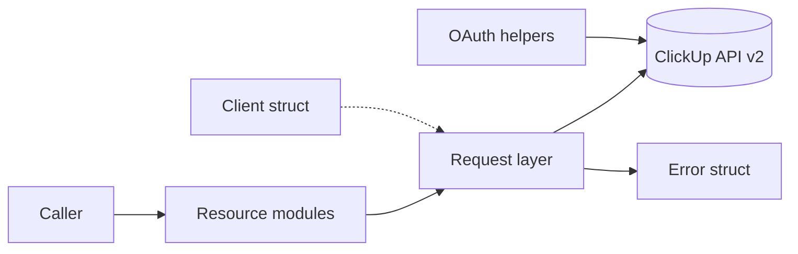

# Project Architecture — Summary

`Noizu.ClickUp` is a thin, stateless, contract-first Elixir client for the
ClickUp API v2, built on Req. No server, no supervision tree, no global state.

## Core Components

- **Client** — config struct (token, auth_style, base_url, req_options, retry
  knobs) passed explicitly to every call; app env is an optional default only.
- **Request** (internal) — single HTTP choke point: Req wiring with built-in
  retry disabled, `key[]` query encoding, bounded 429 retry, error shaping.
- **Error** — one exception struct for API and transport failures
  (`status` / `code` / `message`).
- **12 resource modules** + **OAuth** (authorize URL, code exchange) +
  **Webhook** (CRUD + constant-time raw-body signature verification).

## Behavior in Brief

- Calls: `(client, …ids…, payload?, opts)` → `{:ok, map}` |
  `{:error, %Error{}}`; responses are raw string-keyed JSON maps.
- Retry: 429 only — sleep until `X-RateLimit-Reset` clamped to 15 s, max 2
  retries, then return the 429 as an error. Never 5xx/timeouts.
- Pagination: `page`-based (tasks, `last_page`) and cursor-based (comments,
  `start` + `start_id`); stream variants yield items and raise on failure.
- Auth: raw `Authorization: pk_…` (personal, default) or `Bearer` (OAuth).
- Scope: v2 only; v3, attachments, goals, views, webhook payload parsing, and
  OAuth refresh are intentional non-goals (contract § 6).

## Key Decisions

Explicit client over global state · contract-first (`docs/API-CONTRACT.md` is
the source of truth) · thin unmodified responses · v2 only · single retry
layer (429-only, Req retry disabled) · raw-body constant-time signature checks.

## Detail Documents

- [arch/data-flow.md](arch/data-flow.md) — request lifecycle, query encoding, pagination
- [arch/error-retry.md](arch/error-retry.md) — error struct, retry policy, stream semantics

Components ↔ directories: [PROJ-LAYOUT.md](PROJ-LAYOUT.md)
