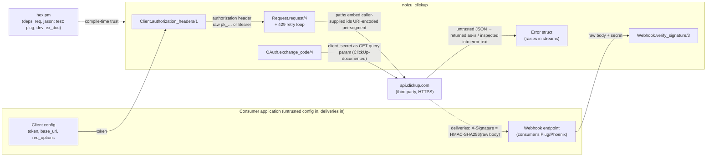

# Threat Model

<!-- 〚📁:69cf345d-6e03-5245-af86-d6c46c43409d〛 noizu_clickup:threat_model :: Living threat model — trust boundaries, attack surface, register T-001..T-009, positive controls, residual risk. -->

Living threat model for `noizu_clickup` — an Elixir client library for the
ClickUp API v2. **This is a library, not a service**: it has no listening
ports, no data store, and no persistence. Its crown jewels are (1) the ClickUp
token entrusted to it by the consumer, (2) the correctness of the webhook
signature check consumers rely on, and (3) its dependency tree, which runs
inside consumer applications. The model is grounded in
[PROJ-ARCH.md](PROJ-ARCH.md) / [arch/](arch/) and verified against the code on
2026-10-17 (v0.1.0).

## Trust Boundaries

1. **Consumer application ↔ library** — the library trusts consumer-supplied
   config (`token`, `base_url`, `req_options`). Anything the consumer passes is
   executed as-is; config tampering is outside the library's control but in its
   blast radius.
2. **Library ↔ `api.clickup.com`** — HTTPS egress. Responses are **untrusted
   data**: decoded JSON returned as-is, never executed or pattern-matched into
   control flow.
3. **ClickUp → consumer's webhook endpoint** — a network ingress owned by the
   consumer; this library contributes the verification helper
   (`Webhook.verify_signature/3`) consumers depend on to trust those deliveries.
4. **Hex.pm → build** — dependency supply chain; the library's deps compile
   into every consumer's release.

## Attack Surface

→ *Full enumeration: [threats/attack-surface.md](threats/attack-surface.md)*

## Vulnerability Register

<!-- 〚🧩:5a5babcb-f098-5d4e-a190-fd9fe9daf895〛 noizu_clickup:vuln_register :: Vulnerability register — nine entries with severity, STRIDE category, component, and status. -->

| ID | Severity | STRIDE | Component | Finding | Status |
|----|----------|--------|-----------|---------|--------|
| T-001 | **High** | Info disclosure | `Client` struct | No redacting `Inspect` impl — `inspect(client)`, debug logs, or telemetry of the struct prints the **raw token** | **Mitigated 2026-10-17** (`defimpl Inspect` masks `token` to a ≤4-char prefix + `[REDACTED]`; evidence: `Noizu.ClickUp.RedactionTest` "inspect/1 of a client never contains the raw token") |
| T-002 | Medium | Info disclosure | `OAuth.exchange_code/4` | `client_secret` travels as a **GET query param** (ClickUp's documented form) — visible to intermediary/proxy/access logs | Accepted (API-mandated; see [token-handling](threats/token-handling.md)) |
| T-003 | Medium | Spoofing / Repudiation | `Webhook.verify_signature/3` | Signature covers the body only — **no timestamp/nonce**, so a captured delivery replays verbatim and verifies `true` indefinitely | Open — inherent to ClickUp's scheme; consumer guidance (raw-body verify + dedupe on `webhook_id`/`event`/`history_items[].id`) is now in the `Webhook` moduledoc and README (see [webhook-signature](threats/webhook-signature.md)) |
| T-004 | Medium | Supply chain | `mix.lock` tree | Compromise of a Hex package (`req` → `finch` → `mint`/`castore`, `jason`, …) executes inside every consumer and can exfiltrate tokens | Mitigated (pinned lockfile w/ sha256, minimal runtime deps, pure Elixir, no NIFs/git/path deps; residual Hex-registry risk accepted — see [supply-chain](threats/supply-chain.md)) |
| T-005 | Low | Tampering | Resource modules | Resource ids are interpolated **unescaped** into URL paths (`"/task/#{task_id}"`) — a crafted id can alter the path/query (confused deputy within the ClickUp API) | **Mitigated 2026-10-17** (all ids encoded via `Noizu.ClickUp.Request.segment/1` (`URI.encode/2` + `char_unreserved?`); evidence: `Noizu.ClickUp.PathEncodingTest` "an id with traversal and query material stays one opaque segment") |
| T-006 | Low | Info disclosure | `Client` / `OAuth` | `base_url` override sends the token to an arbitrary host — config typo or tampering exfiltrates credentials | Accepted (feature by design; consumer config is trusted boundary) |
| T-007 | Low | DoS | `Request` retry loop | 429 retry **blocks the caller** up to `retry_cap_ms` (15 s) × `max_retries` (2) ≈ 30 s in a synchronous `Process.sleep/1` — calling from a LiveView/GenServer stalls that process | Mitigated (bounded by construction; consumer placement guidance — see [retry-behavior](threats/retry-behavior.md)) |
| T-008 | Low | Info disclosure | `Error` struct | Non-map error bodies are `inspect`ed (truncated to 500 chars) into `message` — upstream error content can reach consumer logs/crash reports | Mitigated (truncation; **no token ever enters the error path** — `error.ex` builds messages from status/body only) |
| T-009 | Low | Spoofing | `Client.new/1` app-env defaults | Token stored in `:noizu_clickup, :client` app env is readable by any code on the BEAM node | Accepted (documented optional convenience; consumer discipline) |

<!-- 〚/🧩:5a5babcb-f098-5d4e-a190-fd9fe9daf895〛 -->

## Mitigation Coverage

6 mitigated · 1 open · 2 accepted. The remaining open item is T-003 (webhook
replay), inherent to ClickUp's scheme — the library now documents the effective
consumer mitigations (raw-body verification + dedupe) in the `Webhook`
moduledoc and README. Accepted items are re-reviewed whenever ClickUp changes
the auth/webhook scheme.

→ *Control details: [threats/token-handling.md](threats/token-handling.md) ·
[threats/webhook-signature.md](threats/webhook-signature.md) ·
[threats/retry-behavior.md](threats/retry-behavior.md) ·
[threats/supply-chain.md](threats/supply-chain.md)*

## What Is Done Right (positive controls)

- **Redacting `Inspect` on the client** — `inspect/2` of `%Client{}` masks the
  token to a ≤4-character prefix + `[REDACTED]` (T-001), so debug logs,
  telemetry, and crash reports never carry the raw credential (test-covered).
- **Constant-time signature compare** — `verify_signature/3` recomputes
  HMAC-SHA256 over the raw body, guards byte length, then compares via
  `:crypto.hash_equals/2` (constant time); wrong length, wrong secret, tampered
  body, and missing/`nil` signatures all fail closed to `false` (test-covered).
- **No token in error paths** — `%Error{}` messages are built from HTTP status
  and the response body only; Req itself additionally redacts the
  `authorization` header in `%Req.Request{}` inspect output (verified in
  req 0.7.5).
- **Single, bounded retry layer** — Req's built-in retry is disabled; only 429
  is retried, at most `max_retries` times, sleeps clamped to `0..retry_cap_ms`
  regardless of what an untrusted `X-RateLimit-Reset`/`Retry-After` value says
  (negative, past, garbage, or far-future values included; test-covered with an
  injectable sleep). Mutations are never re-sent on 5xx/timeouts.
- **Fail-fast configuration** — building a token-less client raises
  `ArgumentError` before any HTTP; unknown `new/1` keys raise via `struct!/2`.
- **Hermetic tests** — all suites run against `Req.Test` stubs; no live tokens
  or network in CI.

## Residual Risk (accepted, with reasons)

- **Token visibility on the BEAM** (T-006, T-009-adjacent): any code in the
  consumer node can read app env or process memory. A client library cannot
  defend a compromised host; accepted with consumer guidance (scope tokens,
  keep them out of shared app env in multi-tenant nodes).
- **Hex registry compromise** (T-004): lockfile checksums pin what is fetched
  today, but a malicious *update* pushed upstream would only be caught by
  review of `mix.lock` diffs. Accepted for a v0.1.0 library; revisit if this
  becomes a widely-deployed dependency (then: CI `mix hex.audit` + dependabot
  + diff review on any lockfile change).
- **BEAM crash dumps** (`erl_crash.dump`, gitignored) may contain the token in
  process memory. Generic platform risk; consumers control dump handling.

## Maintenance

Re-run this model whenever: the auth scheme changes (ClickUp deprecates
non-expiring tokens), the webhook signature scheme gains anti-replay material,
a new runtime dependency is added, or an endpoint gains user-controlled path
segments beyond ids. Update the register in place — IDs are stable.
